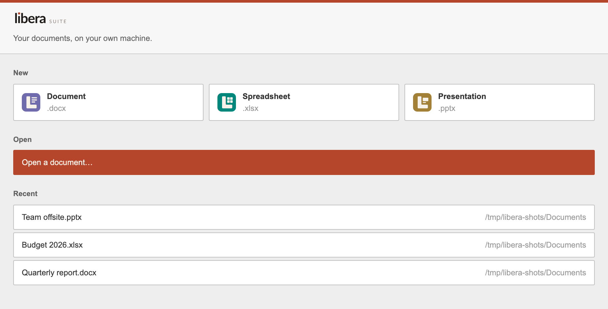

# Work with documents

## Open

```sh
libera                             # the start window
libera ~/Documents/note.docx
libera ~/Documents/budget.xlsx
libera ~/Documents/network.vsdx
```

**The document decides which application you get.** There is no command to pick one, in the same way there is no command to pick a text editor for a `.txt`: you open the document and the right application comes up. An `.xlsx` opens in Tables, a `.pptx` in Slides, a `.vsdx` in Diagrams, a `.pdf` in Libera PDF.



`libera` on its own opens the **start window**: a new document of any kind, an open dialog, your recent documents, and where the components came from. Pick something and the start window goes away, leaving you with the document.

Libera Suite opens **one document per window**, so a shell glob does what it looks like it does:

```sh
libera ~/Documents/*.docx     # one window each
```

You can also open a document from inside the document window, through **File ▸ Open** or **File ▸ Open Recent**. Either opens a new window; neither disturbs the document you already have open.

**On macOS, documents can open as tabs** of one window. Libera Suite follows the system's setting, *Prefer tabs when opening documents* in System Settings ▸ Desktop & Dock, as every Mac document application does. Set to *Always*, each document opens as a tab. Otherwise it opens in a window of its own, and **Window ▸ Merge All Windows** gathers them. The **+** at the end of the tab bar opens the start window as a new tab, and the document you choose there takes its place. A tab can be dragged out into a window of its own.

**Dropping a document** on any Libera Suite window, the start window included, opens it in a window of its own. An image dropped on a document is inserted into it.

**File ▸ New** offers a Document, a Spreadsheet or a Presentation from any window, each in a window of its own. On macOS, `⌘N` makes one of the same kind as the front window. Inside the document window, you get the same choice from **File ▸ Create New**.

## Save

**File ▸ Save** writes back to the document you opened. **File ▸ Save As** asks where to put it. From then on that is the document you are editing.

Saving converts the working format back into a real document, which takes about a second.

## Export

Save As is also how you export: its dialog has a **File Format** popup.

| | |
| :--- | :--- |
| Word Document | `.docx` |
| Word Template | `.dotx` |
| OpenDocument Text | `.odt` |
| OpenDocument Template | `.ott` |
| PDF | `.pdf` |
| Rich Text Format | `.rtf` |
| HTML | `.html` |
| Markdown | `.md` |
| EPUB | `.epub` |
| FictionBook | `.fb2` |
| Plain Text | `.txt` |

Choosing a format renames the file in the dialog. The dialog will not let the two disagree: you cannot end up with an ODT called `.docx`.

Not every format the converter can read is one it can write. `.doc` in particular opens but does not save; use `.docx` or `.rtf` for something that has to go back to an old Word.

If you are looking for a **Download As** entry in the File menu, there isn't one. The components hide it when they run as an offline desktop application and put Save As in its place: the same job, one menu entry earlier.

### From the command line

`libera --convert` does the same without opening a window, for one document or a hundred. The format is named by its extension, with `-t`, or taken from the name given to `-o`:

```sh
libera --convert *.docx -t pdf             # report.pdf beside report.docx, and so on
libera --convert talk.pptx -o talk.odp     # one document, named
libera --convert *.xlsx -t ods --outdir ods/
libera --convert report.docx -t pdf -o - | lp   # to standard output
```

A file already there under the new name is replaced. Nothing is written over the file being converted, and two files that would end up under one name are refused before anything is converted. The spellings are pandoc's, except that there is no `-f`: the extension says what a file is.

## The menu bar

On Linux and Windows the bar sits inside the window: **File**, **Edit**, **View** and **Help**, the last holding *Libera Help* and *About Libera Suite*. Three differences follow from what the menu there offers. On Linux, New, Open and Close show Ctrl-N, Ctrl-O and Ctrl-W beside them, and no other item shows its key; on Windows none does. Ctrl-N, Ctrl-O, Ctrl-W, Ctrl-S, Ctrl-Shift-S, Ctrl-P and Ctrl-Z do what the ⌘ keys below do on a Mac. **Open Recent** is built when the application starts, so a document you open today appears in it tomorrow. Nothing greys out, so Save with nothing to save does nothing.

On macOS it is a real Mac menu bar, with the same items plus **Window**. The usual shortcuts work there whether or not the document has focus:

| | |
| :--- | :--- |
| `⌘N` `⌘O` | New (of the front window's kind), Open: each in its own window, or tab |
| `⌘S` `⇧⌘S` | Save, Save As |
| `⌘P` | Print |
| `⌘W` | Close, asking about unsaved changes first |
| `⌘Z` `⇧⌘Z` | Undo, Redo |
| `⌘F` | Find |
| `⌘?` | This documentation |
| `⌘+` `⌘-` `⌘0` | Zoom in, out, fit the page |
| `⌘8` | Formatting marks |

**File ▸ Open Recent** is rebuilt each time you open it. The **Window** menu lists every open document.

Save, Undo and Redo are greyed out when there is nothing to save or undo. The components decline those silently: a menu item that stayed available would look broken.

## Closing

Closing a window with unsaved changes asks first: **Save**, **Don't Save** or **Cancel**.

Choosing Don't Save is not final. Libera Suite keeps what you wrote, and offers it back the next time you open that document.

## Print

**File ▸ Print**, or the printer button, renders the document to PDF, asks where to keep it (in the document's folder unless you choose another), and opens it in your system's PDF viewer, where the print dialog lives.

That is the choice for now: the viewer you already have gives you page ranges, paper size, scaling and a preview, none of which we would build better in the first version.

## Images

Images embedded in a document are preserved on open and save. **Insert ▸ Image** adds an image from disk.

## PDFs

A `.pdf` opens in **Libera PDF**. Libera Suite is offered in *Open With* for a PDF, never as the default: a double-click still opens it in your usual viewer.

- **Comment.** The **Comment** tab has *Text Comment*, *Highlight*, a pen, shapes and a text box.
- **Fill in a form.** Click a field and type, tick a box, choose from a list. Many official forms are made with Adobe LiveCycle Designer and carry a second copy of the form that only Acrobat reads. Saving leaves that copy out, so that Acrobat shows the values you filled in, as other readers do.
- **Change the pages.** Right-click a page for *Insert blank page after*, *Delete page* and *Rotate page*. Drag a page's thumbnail to move it.
- **Change a line of text**, with *Edit PDF*, then *Edit Text*. Use it for small corrections. The new words are set in one of our fonts when the PDF's own cannot be used, and a line that grows does not reflow: what no longer fits goes to a line of its own.

**Saving adds to the file.** Your changes are written after the PDF's original content, which stays exactly as it was. A signature that permits comments therefore stays valid for what it signed. A PDF saves only as a PDF.

**A PDF that asks for a password** opens once you give it, and saves with your changes, still under the same password. **A PDF certified against any change cannot be saved**: the save fails and says so, the file is left as it was, and your changes stay in the window.

Creating a form is not possible yet, nor converting a PDF into a document.

## Documents with a password {#passwords}

A document protected by a password, by Word, LibreOffice or Libera Suite, asks for it as it opens, and again after a wrong one. Saving keeps the password: the file is written protected, as it was. A print is a PDF protected by the same password. Saved as text, CSV, RTF, HTML, Markdown, EPUB or FB2, the document is not protected, since those formats have no protection.

**LibreOffice 26's own protection cannot be read yet.** By default, LibreOffice 26 encrypts an OpenDocument file in a way Libera Suite does not read, and Libera Suite says so instead of asking for the password. LibreOffice writes the older encryption, which Libera Suite reads, when its ODF format version is set to 1.3.

Giving a document a password, or changing or removing one, is not possible yet.

## Spell checking

Misspellings are underlined, and right-click offers suggestions. Which dictionary is used follows **the document's language**, which you set from the **status bar** at the bottom of the window, per document.

Dictionaries for six languages ship: English (US and UK), French, German, Spanish, Italian and Dutch. A language with no dictionary is not an error; its words are simply treated as correct. Words you add through *Add to dictionary* are kept: from then on they are correct in every document and every language.

## Your name in documents

Tracked changes and comments are attributed to a person, whose name is written into the saved file. Libera Suite takes it from your account: your full name as macOS knows it, the display name of your Windows account, or the full-name field of your Unix account on Linux, falling back to your login name.

To use another name, put it in the configuration file, creating the file if it is not there:

```toml
user_name = "Jeanne Dupont"
```

| | |
| :--- | :--- |
| Linux | `$XDG_CONFIG_HOME/libera/config.toml`, or `~/.config/libera/config.toml` |
| Linux, Flatpak | `~/.var/app/eu.liberasuite.Libera/config/libera/config.toml` |
| macOS | `~/Library/Application Support/Libera Suite/config.toml` |
| Windows | `%USERPROFILE%\.config\libera\config.toml` |

It applies to the windows opened after Libera Suite next starts. Documents saved before keep the name they were saved with.

The same file turns off the daily check for a newer version, with a line of its own:

```toml
check_updates = false
```

And one keeps to the fonts Libera Suite ships, leaving out those installed on your machine, so that a document looks the same on every computer:

```toml
installed_fonts = false
```

And one sets the language of the applications, when it should not be your system's. A new document still takes its paper size from your system's region:

```toml
ui_language = "fr"
```

To use another file for one run, without touching this one, name it with `libera --config FILE` (or `-c FILE`), or in the `LIBERA_CONFIG` environment variable. A Libera Suite started that way does not hand its documents to one already running, which would open them with its own configuration: quit that one first.

## Where your working files go

While a document is open, Libera Suite keeps a session directory alongside its application data. It holds the working copy and a running log of your changes, which makes saving fast and undo reliable. It is not a backup: the document is where you saved it.

For a document with a password, that working copy is not encrypted while the document is open, so anything that can read your account's files can read it. It is kept all the same, as for any document, so that your changes survive a crash, and getting them back asks for the password again.

---

[What works today](../main/status.md) is the next page: what is built and the problems we already know about. If you meet one that is not on that list, [tell us](../feedback.md).
