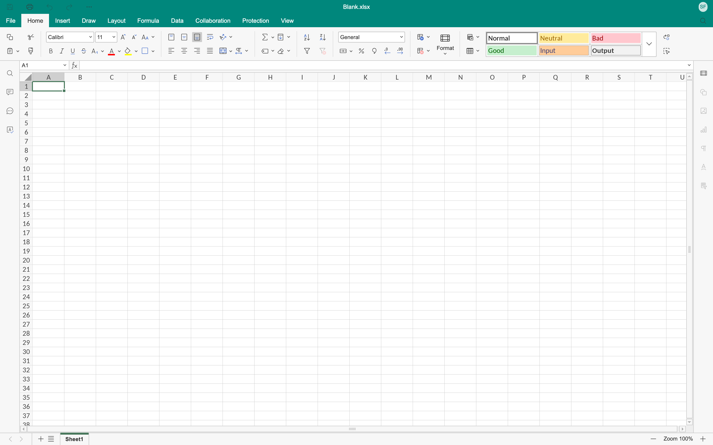
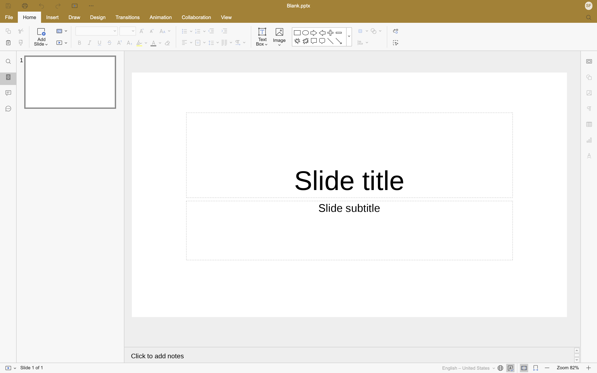

# Using Libera Suite

Libera Suite opens a document in a window and lets you edit and save it. Words, Tables and Slides all work that way; Diagrams opens Visio files to read.

Start at [Install](../main/install.md). These three pages are meant to be read in order:

1. [Install](../main/install.md): getting it onto your machine, in one command.
2. [Work with documents](documents.md): opening, saving, exporting, printing.
3. [What works today](../main/status.md): what is built, plus the problems we already know about.

Each application has its own colour. Everything else about the window is the same:

## The shape of it

Libera Suite is two pieces, packaged separately.

**The application** is a small Python package. It is a few hundred kilobytes: the window, the command line, and the host that the components talk to.

**The components** are everything else: the document engine, the editing components, the fonts. The command line calls them the *payload*. It is about 100 MB compressed, in two Python packages of its own, `libera-core` and `libera-web`.

They are versioned separately. The application checks that the components it finds are the ones it expects. A fix to the application therefore does not mean downloading the components again.

Every way of installing brings both. The Windows installer and the Linux Flatpak contain them, and pip installs the components with the application, which requires them.

## What it is not

Libera Suite talks to no server, needs no account and never uploads your documents. The components run as local web content served over `127.0.0.1` to a window on your own machine. There is no collaboration, cloud storage or telemetry, because none of it is built.
